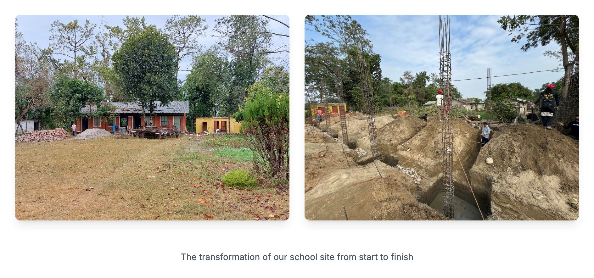

<div align="center">

<h1>Schoolhouse Sherpas</h1>

<p><b>A buildOn school-building trek, told day by day.</b></p>

<p><i>Eleven volunteers spent a week in Basanta, Nepal, digging the foundation for a new school. This is the photo story of that week.</i></p>

<h6>


-555555?style=flat-square)

</h6>

<a href="https://buildon-nepal-trek.vercel.app"><b>Live site</b></a> ·
<a href="#how-it-works"><b>How it works</b></a> ·
<a href="#run-it"><b>Run it</b></a>

<br><br>

<a href="https://buildon-nepal-trek.vercel.app"></a>

<sub>The school site before and after the build week, as shown on the live site.</sub>

</div>

<br>

In January 2025 a team called Schoolhouse Sherpas travelled to Basanta, in far-western Nepal,
with [buildOn](https://www.buildon.org), a nonprofit that builds schools alongside the
communities that will use them. The team had spent the year before fundraising (guest
bartending nights, a pickleball tournament) toward a $55,000 goal covering the school and
trek costs. This site is the write-up: one long post, from landing in Kathmandu through seven
days of digging, rebar work, cement mixing, community meetings and the farewell, told in two
alternating voices with photos and short clips on every day.

## How it works

The whole site is a single page that renders one Markdown file.

| Piece | What it does |
|---|---|
| `_posts/buildon-trek-nepal-jan-2025.md` | The story. Front matter (title, date, cover) via `gray-matter`, body in Markdown with inline HTML galleries |
| `src/lib/markdownToHtml.ts` | `remark` + `remark-gfm` + `remark-html`, with raw HTML allowed so the `<div class="smart-gallery">` blocks pass through |
| `src/app/_components/post-body.module.css` | Gallery grid, captions and typography for the rendered post |
| `src/app/_components/ImageModal.js` | Click any photo to open it full screen; click outside to close |
| `public/assets/blog/...` | About 80 photos and GIFs (video clips converted to GIF) |

Two helper scripts keep the media in order:

- `npm run convert-videos` turns video clips into 480 px, 10 fps GIFs with `ffmpeg`.
- `npm run check-images` lists images the post references but are missing, and files in the
  assets folder the post no longer uses.

## Run it

```bash
git clone https://github.com/parthchandak02/buildon-nepal-trek.git
cd buildon-nepal-trek
npm install
npm run dev        # http://localhost:3000
```

The live site is hosted on Vercel. To change the story, edit the Markdown file in `_posts/`
and drop new photos into `public/assets/blog/buildon-trek-nepal-jan-2025/`.

<br>

<div align="center">
<sub>Built with Next.js, remark and Tailwind CSS, starting from the Next.js blog-starter example.</sub>
</div>
